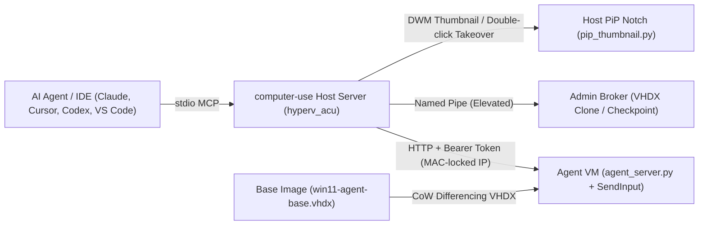

# agent-computer-use

**Give AI agents a real Windows desktop—without giving up yours.**

`agent-computer-use` spins up isolated, ephemeral Windows sandboxes on local Hyper-V and exposes full desktop control (`screenshot`, `click`, `move`, `drag`, `scroll`, `key`, `type`, `batch`, `exec_powershell`) over MCP.

You keep working on your host. Your agent works inside its own sandboxed VM, with a live picture-in-picture notch on your screen—double-click it anytime to open the VM window and take over.

<!-- Drop demo GIF here once recorded:  -->

## Architecture



## Why not run on your host or a cloud VM?

| | Host Desktop | Cloud Sandbox | **agent-computer-use** |
| :--- | :--- | :--- | :--- |
| **Mouse & keyboard** | Fights you for control | Isolated | **Isolated** |
| **Credentials & files** | Exposed to agent | Uploaded to cloud | **Stays local** |
| **Cost & latency** | Free, local | Per-minute billing + lag | **Free, local** |
| **Reset / rollback** | Manual cleanup | Snapshot / destroy | **Instant VHDX clone & checkpoint** |

## Quickstart

Requires Windows 10/11 Pro, Enterprise, or Server with Hyper-V enabled and Python 3.11+.

```powershell
pip install -e .
powershell -ExecutionPolicy Bypass -File scripts\setup.ps1 -InstallClients all
```

`setup.ps1` registers `computer-use` across your IDEs—or target directly:

- **Claude Code & Claude Desktop**: `claude mcp add -s user computer-use -- python -B -u src/hyperv_acu/server.py` (`setup.ps1 -InstallClients claude-code,claude-desktop`)
- **ChatGPT & Codex**: `scripts\install-mcp.ps1 -Clients codex` (or copy `.codex-plugin/tunnel.yaml.example` and run `scripts\connect-tunnel.ps1` for remote tunnel)
- **Cursor, Antigravity, VS Code & others**: `scripts\install-mcp.ps1 -Clients cursor,antigravity,vscode`

## What the agent gets

All observation and input tools operate **desktop-wide by default** (with optional `target_id` for window-level scoping):

- **Lifecycle**: `create_vm`, `start_vm`, `stop_vm`, `checkpoint_vm`, `restore_vm`, `destroy_vm`
- **Vision**: `screenshot` (full virtual screen + visible window bounds), `window_snapshot`, `list_windows`
- **Input**: `click`, `move`, `drag`, `scroll`, `key`, `type`, `wait`, `batch`
- **Shell**: `exec_powershell`

## How it stays safe

- **Same pattern as cloud sandboxes**: copy-on-write differencing VHDX clones (`win11-agent-base.vhdx`) boot in seconds and delete cleanly on `destroy_vm`.
- **MAC-locked networking**: resolves each VM strictly by static virtual MAC over the private Hyper-V switch—no exposed ports.
- **Human-takeover safe**: pauses/refuses agent input when you interact with the VM; double-click the host PiP thumbnail to jump straight into `vmconnect.exe`.

## Project layout

- `src/hyperv_acu/`: host MCP server, VM pool, guest proxy, safety guards, DWM PiP overlay
- `guest/`: guest-side FastMCP server (`agent_server.py`) and Win32 capture/input modules
- `skills/`: agent skills (`computer-use`, `sandbox-lifecycle`)
- `config/`: `settings.json` defaults and `settings.example.json`
- `scripts/`: `setup.ps1`, `install-mcp.ps1`, `provision-base.ps1`, `deploy-guest.ps1`, `admin-broker.ps1`
- `.codex-plugin/`: Codex plugin manifest + `tunnel.yaml.example`
- `tests/`: unit tests (`python -m unittest discover -s tests -t .`)

## FAQ

**How is this different from Playwright or browser-use MCP?**
Browser tools only automate DOM/webpages. `agent-computer-use` controls an entire Windows OS—native desktop apps, installers, terminals, system dialogs, and browsers—inside an isolated VM.

**Do I need cloud GPUs or external APIs to host the sandbox?**
No. Everything runs locally on Windows Hyper-V using differencing VHDX images and local virtual networking.

**Can I run multiple isolated Agent VMs at once?**
Yes. `vm_pool.py` tracks multiple managed VMs (`ephemeral` or `persistent`) up to `max_managed_vms`, routes each tool call by `vm_id` and virtual MAC, and launches a dedicated host PiP thumbnail for each active VM.

## License

MIT
